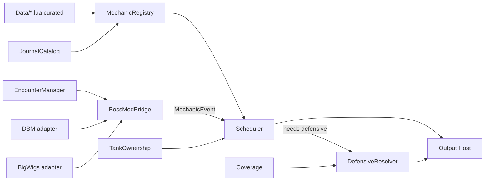

# CLAUDE.md: OrionUI (working name)

> This file is the project brief for Claude Code. Read it fully at the start of every session.
> It captures every decision, finding, and constraint worked out during planning.
> When something here turns out to be wrong in-game, fix the code AND update this file.

**Working name:** `OrionUI`. This is a placeholder until Stig picks the final name. All
names derive from one place (see §6.1), so a rename is a find-and-replace on folder/TOC/global
names plus the `ns.NAME` constant. Do not hardcode the name in strings elsewhere.

**Owner:** Stig. Plays World of Warcraft (Retail, Midnight expansion, interface 12.x), mains tanks
(Blood Death Knight among others), raids with the Orion guild.

---

## Table of contents

1. What we are building
2. Hard rules (read these twice)
3. Ground-truth sources and how to use them
4. The WoW 12.x (Midnight) restriction model
5. Repository layout
6. Core framework design
7. Encounter and reminder engine (Smart Reminders–style)
8. Tank and class modules
9. Options window, edit mode, and look & feel
10. Profiles, import/export, and the public API
11. External addon integration facts (verified from source)
12. The installer (later phase)
13. Style direction for the pack
14. Lessons from analysed competitor packs
15. Coding standards
16. Testing and debugging
17. Packaging and release
18. Roadmap
19. Open questions / decisions pending
20. Glossary

---

## 1. What we are building

A **free**, extremely polished UI pack for WoW Retail, built on top of **EllesmereUI (EUI)**,
eventually published on CurseForge. It consists of multiple addon folders:

| Addon folder | Role | Phase |
|---|---|---|
| `OrionUI` | **The core.** Every setting, profile, module, and feature lives here: the framework, the options window, the encounter/reminder engine (Smart Reminders–style defensive caller), tank/class helpers, QoL features, and the public API. | **First** |
| `OrionUI_Installer` | Load-on-demand installer wizard that pushes preset profiles into EUI, BigWigs, DBM, Northern Sky Raid Tools, Waypoint UI, RaidControll, Blizzard Edit Mode / Cooldown Manager, and into `OrionUI` itself. Holds the large preset strings so the core stays light. | Later |
| `OrionUI_Dev` | Developer-only probes and diagnostics (never shipped to CurseForge, or shipped disabled). | First (tiny) |

**The first task is the core addon `OrionUI`**, with the framework built so everything else
(reminders, tank modules, QoL, installer hooks) plugs into it without rewrites.

### 1.1 The user experience goal

- Installing the pack: user installs addons, logs in, a single polished wizard appears, they pick
  a resolution (and optionally role/variant), click through, reload, done.
- Day-to-day: one options window for everything OrionUI does, styled to look native inside EUI.
- In combat: clean, minimal, readable. Reminders tell a tank *what to press, when*, and never
  suggest a defensive that is on cooldown or already active.

### 1.2 Non-goals (for now)

- Not rebuilding unit frames, nameplates, action bars, etc. EUI does that. We configure EUI.
- Not a boss mod. BigWigs/DBM provide timing; we ride their events.
- Not a WeakAuras replacement.

---

## 2. Hard rules (read these twice)

1. **Free, forever, no gating.** Blizzard's UI Add-On Development Policy requires addons be free
   of charge and not paywalled. No feature may be locked behind payment or a Patreon tier.
   Donations are fine only if nothing is gated. Code must not be obfuscated.
2. **Never copy another pack's content.** We studied KiraUI and Naowh Smart Reminders
   (analysis docs exist locally, see §14). Architecture *ideas* are fair to use. Their *content*
   is not: no copying their code, preset strings, curated data tables (e.g. Kira's reminder rows,
   Naowh's tank-owner / tankbuster tables), textures, fonts, or sound/voice files. We author all
   data and media ourselves.
3. **Never bundle or copy EllesmereUI code.** EUI's license is "All Rights Reserved". We only
   call its public functions and ship *settings* for it. EUI is a dependency, never embedded.
   Same for Northern Sky Raid Tools (All Rights Reserved) and Waypoint UI (no license file).
4. **Do not circumvent deliberate gates.** EUI's `RegisterModule` refuses callers outside its own
   folders (see §11.1.4). There are technical ways around the caller check. **Do not use them.**
   We ask the author for an official hook instead.
5. **Never destroy user data.** Any import that overwrites something must back it up first.
   For NSRT specifically: never touch nicknames, reminders, or timeline data (§11.5).
6. **Never block, taint, or error in combat.** All protected operations are deferred out of
   combat. All work touching secret values follows §4. No `ADDON_ACTION_BLOCKED`/`FORBIDDEN`.
7. **Fail loudly in dev, gracefully for users.** No silent `pcall` swallowing. Errors go to our
   log (and `geterrorhandler()` in dev); users get a clear message, not a Lua error popup.
8. **Keep the analysis docs of paid addons out of any public repo.** They live in
   `/docs-private/` which is gitignored (§5).
9. **Verify before asserting.** Anything in this file marked **[VERIFY]** has not been confirmed
   in-game. Confirm it (usually via `OrionUI_Dev` probes) before building on it, then update this
   file.

---

## 3. Ground-truth sources and how to use them

Clone these into a sibling folder (on Stig's machine: `C:
efs`, never inside the repo) and grep
them instead of guessing APIs:

| Source | URL | Use it for |
|---|---|---|
| Blizzard UI source + generated API docs | `https://github.com/Gethe/wow-ui-source` | **Authoritative** API signatures, `SecretWhen…`/`NeverSecret` annotations, events. Look in `Interface/AddOns/Blizzard_APIDocumentationGenerated/`. |
| EllesmereUI | `https://github.com/EllesmereGaming/EllesmereUI` | Import API, skinning API, unlock mode, CDM structure, profile format. |
| LibAddonProfiles (Wago UI Packs) | `https://github.com/methodgg/Wago-Creator-UI` → `WagoUI_Libraries/LibAddonProfiles` | Per-addon import modules for the installer. GPLv2. |
| Deadly Boss Mods | `https://github.com/DeadlyBossMods/DeadlyBossMods` | DBM callbacks, profile structure. |
| BigWigs | `https://github.com/BigWigsMods/BigWigs` | BigWigs messages/callbacks, `BigWigsAPI`. |
| Northern Sky Raid Tools | `https://github.com/Reloe/NorthernSkyRaidTools` | Saved variable layout (read only; don't copy). |
| Waypoint UI | `https://github.com/adaptvx/Waypoint-UI` | Saved variable layout (read only; don't copy). |

Useful sparse clone for Blizzard API docs only:

```bash
git clone --depth 1 --filter=blob:none --sparse https://github.com/Gethe/wow-ui-source.git refs/wowui
cd refs/wowui && git sparse-checkout set Interface/AddOns/Blizzard_APIDocumentationGenerated
```

Before using any API: grep its documentation entry and check for `SecretWhen…`, `SecretArguments`,
`NeverSecret`, `MayReturnNothing`, and restricted-event annotations.

---

## 4. The WoW 12.x (Midnight) restriction model

Midnight added a "secret value" system. When a restriction is active (combat, encounters,
M+, etc.), many API results become **secret**: insecure addon code can pass them to engine
widgets for *display* but cannot *read, compare, do arithmetic on, or branch on* them.
Violating this errors or taints.

### 4.1 Rules we follow

- **Detect before use.** Use the global `issecretvalue(v)` (and `issecrettable(t)`; both confirmed in the API docs) before comparing or doing math on anything that can be secret. Wrap this in
  `ns.Secret` helpers (§6.6); never scatter raw checks.
- **Display, don't compute.** Feed secret cooldown data to Blizzard cooldown widgets / duration
  objects (`C_Spell.GetSpellCooldownDuration` returns a duration object) instead of calculating
  remaining time ourselves.
- **Engine-side visuals for secret booleans.** `C_CurveUtil.EvaluateColorValueFromBoolean`
  (and curve/"sink" helpers) let the engine turn a secret boolean into an alpha/color without Lua
  ever learning the value. This is the fallback for "fade out defensives that aren't ready".
- **Restriction state is observable.** `C_RestrictedActions.GetAddOnRestrictionState(type)`,
  `C_RestrictedActions.IsAddOnRestrictionActive(type)`, and event
  `ADDON_RESTRICTION_STATE_CHANGED` (fires before a restriction activates / after it lifts).
  Cache the state and let modules subscribe via our event bus.
- **Blizzard has its own boss timeline in 12.x** (`C_EncounterTimeline`, `ENCOUNTER_TIMELINE_EVENT_*`).
  Its `spellID`/`spellName` can be secret while `duration` is not, and BigWigs consumes it. Boss-mod
  keys may therefore not map cleanly to spell IDs. See `docs/verification-log.md`.
- **Combat log may be restricted.** Check `C_CombatLog.IsCombatLogRestricted()` before
  registering `COMBAT_LOG_EVENT_UNFILTERED`. If restricted, don't register (it can cause
  `ADDON_ACTION_FORBIDDEN`). Everything must degrade gracefully without CLEU.
- **Scrub at boundaries.** Payloads arriving from BigWigs/DBM callbacks can contain secret values.
  Scrub/validate at the bridge (§7.4) so everything downstream receives plain values.
- **Unit tokens beat GUIDs.** Boss GUIDs can become secret; `boss1..boss5` tokens remain usable.
  Design ownership logic around unit tokens.
- **Aura sounds via the engine.** `C_UnitAuras.AddAuraSound` registers aura-triggered audio that
  the engine plays, without Lua reading enemy aura state. Useful for trash warnings later.

### 4.2 Cooldown readiness: the key open question **[VERIFY FIRST]**

From Blizzard's generated docs (`SpellDocumentation.lua`, `SpellSharedDocumentation.lua`):

- `C_Spell.GetSpellCooldown(spell)` is annotated `SecretWhenCooldownsRestricted = true`.
- Its `SpellCooldownInfo` struct marks `startTime`, `duration`, `modRate` as potentially secret,
  but **`isActive`, `isEnabled`, and `isOnGCD` as `NeverSecret = true`**.

That implies we *can* branch on "is this defensive on cooldown" in combat, using
`isActive and not isOnGCD`.

**However**, the Smart Reminders analysis says Naowh could *not* branch on readiness and used
`EvaluateColorValueFromBoolean` visual fading plus its own cast-based cooldown model for speech.
Possible explanations: the annotation changed in a recent patch; the whole return is withheld in
some restriction states; charges spells behave differently; or Naowh's code predates the change.

**New finding (2026-09-29, from the API docs):** the `C_Secrets` namespace answers this per spell.
`C_Secrets.GetSpellCooldownSecrecy(spell)` returns `Enum.SecrecyLevel` (NeverSecret / AlwaysSecret /
ContextuallySecret), and `C_Secrets.ShouldSpellCooldownBeSecret(spell)` returns a bool. The docs also
state that *individual spells can be flagged never- or always-secret, overriding restrictions*.
So readiness may be branchable for some defensives and not others. The resolver must decide
**per spell**, not globally. Also: `ShouldCooldownsBeSecret()`, `ShouldAurasBeSecret()`,
`HasSecretRestrictions()`, `GetSpellAuraSecrecy(spell)`, `CanCompareUnitTokens(u1, u2)`.
See `docs/verification-log.md`.

**Answered in game (2026-09-29, see verification log):** in combat and during a dungeon boss encounter,
`isActive` and `isEnabled` stay readable while all timing fields are secret. `ReadinessStrategy.API` is the
default ("on cooldown or not" is known, "time left" is not). Confirmed in Mythic+ as well (2026-09-29).
Player auras are withheld in combat (`GetAuraDataByIndex` throws), so Coverage (§7.8) relies on cast tracking.

**Originally, the very first dev task** was an `OrionUI_Dev` probe (§16.2) that, in and out of
combat and inside an encounter/M+, logs for a list of defensives:
`issecretvalue()` on each field of `GetSpellCooldown`, plus `C_Spell.GetSpellCharges` results
[VERIFY charges API annotations too]. The `DefensiveResolver` (§7.7) is designed with a
**strategy interface** so it works either way:

- `ReadinessStrategy.API`: branch on `isActive`/`isOnGCD` (preferred if verified).
- `ReadinessStrategy.CastModel`: our own model from the player's readable `UNIT_SPELLCAST_SUCCEEDED`
  casts + known base cooldowns (fallback; needed for speech/text anyway if API fails).
- `ReadinessStrategy.EngineVisual`: show all candidates, let the engine fade non-ready ones
  (last resort; can't pick "the one" in Lua).

---

## 5. Repository layout

One git repo, multiple addon folders at the top level (each is a separate folder in
`Interface/AddOns/`).

```text
repo-root/
├── CLAUDE.md                      ← this file
├── README.md                      ← public-facing description
├── LICENSE                        ← see §19 (license decision pending)
├── .pkgmeta                       ← BigWigs packager config (libs as externals)
├── .luacheckrc
├── .editorconfig
├── .gitignore                     ← includes /docs-private/, /refs/, Libs/ fetched externals
├── .github/workflows/release.yml  ← tag → package → CurseForge (§17)
├── docs-private/                  ← GITIGNORED. Competitor analysis docs live here.
│   ├── KiraUI-Addon-Technical-Reference.md
│   └── SmartReminders_Full_Investigation.md
├── docs/                          ← our own design notes (public OK)
│   ├── api.md                     ← public API reference for OrionUIAPI
│   ├── data-authoring.md          ← how to add defensives / tankbusters / owner units
│   └── verification-log.md        ← record of [VERIFY] items and in-game results
├── tests/                         ← busted unit tests for pure-logic modules (§16.1)
│   ├── mocks/wow.lua
│   └── spec/*.lua
│
├── OrionUI/                       ← THE CORE ADDON (phase 1)
│   ├── OrionUI.toc
│   ├── Libs/                      ← LibStub, LibSerialize, LibDeflate (fetched via .pkgmeta;
│   │                                 tools/fetch-libs.sh for local dev). LibSharedMedia is used
│   │                                 when present (EUI loads it) but not embedded.
│   ├── Locales/
│   │   └── enUS.lua               ← all user-facing strings go through L[]
│   ├── Core/
│   │   ├── Init.lua               ← namespace, constants, version, ns.NAME
│   │   ├── Util.lua               ← table/deepcopy/merge, string helpers
│   │   ├── Log.lua                ← ring-buffer logger, debug levels, /oui log
│   │   ├── SafeCall.lua           ← error-reporting pcall wrapper (never silent)
│   │   ├── Secret.lua             ← secret-value helpers (§6.6)
│   │   ├── Events.lua             ← central event + internal message bus (§6.3)
│   │   ├── Combat.lua             ← combat queue, restriction-state cache (§6.7)
│   │   ├── Schema.lua             ← declarative schema + validation (§6.5)
│   │   ├── DB.lua                 ← SavedVariables, defaults, migrations (§6.4)
│   │   ├── Profiles.lua           ← profile stores (layout + reminders), switching (§10)
│   │   ├── Serialize.lua          ← import/export pipeline (§10.3)
│   │   ├── Modules.lua            ← module registry + lifecycle (§6.2)
│   │   ├── Media.lua              ← LibSharedMedia registrations of OUR media
│   │   ├── Pool.lua               ← frame pools for bars/icons
│   │   ├── ProfileIO.lua          ← import/export pipeline with validation report
│   │   ├── API.lua                ← public global _G.OrionUIAPI (§10.5)
│   │   ├── Slash.lua              ← /oui command registry
│   │   └── Boot.lua               ← PLAYER_LOGIN startup (loaded last)
│   ├── UI/                        ← Theme (EUI accent/font), CopyBox, Dialog
│   ├── Modules/                   ← small self-contained feature modules (CombatAlert = reference module)
│   ├── Integrations/
│   │   ├── EllesmereUI.lua        ← detection, accent/font/theme read, RegisterSkin,
│   │   │                             anchoring to EUI CDM/aura groups (§9.3)
│   │   ├── BigWigs.lua            ← BigWigs adapter → normalized events (§7.4)
│   │   └── DBM.lua                ← DBM adapter → normalized events (§7.4)
│   ├── Encounters/
│   │   ├── EncounterManager.lua   ← ENCOUNTER_START/END, instance, difficulty, M+ state
│   │   ├── JournalCatalog.lua     ← Encounter Journal scraping + cache (§7.3)
│   │   ├── BossModBridge.lua      ← merges adapters, dedupe, lifecycle (§7.4)
│   │   ├── MechanicRegistry.lua   ← InternalMechanic objects, ID translation (§7.5)
│   │   ├── EncounterMonitor.lua   ← debug list of live mechanics, /oui test reminder, /oui catalog
│   │   └── TankOwnership.lua      ← bossN ownership, threat, grace, fail-open (§7.6)
│   ├── Reminders/
│   │   ├── Reminders.lua          ← module: settings, per spec×encounter×mechanic bindings
│   │   ├── TankOwnership.lua      ← bossN threat, grace, fail-open (§7.6)
│   │   ├── Readiness.lua          ← cooldown readiness, tri-state (§4.2)
│   │   ├── DefensiveResolver.lua  ← preset chain + readiness strategy + coverage (§7.7)
│   │   ├── Coverage.lua           ← "already covered by an active defensive" (§7.8)
│   │   ├── Scheduler.lua          ← lead times, retrigger guards, queueing (§7.9)
│   │   ├── CustomReminders.lua    ← user-authored reminders (§7.10)
│   │   ├── ObservedTimings.lua    ← (later) learn timings from pulls (§7.11)
│   │   └── Output.lua             ← icon + text + countdown, sound, speech (split when it grows)
│   ├── Classes/
│   │   ├── Framework/
│   │   │   ├── SpecModule.lua     ← base for class/spec modules (§8.1)
│   │   │   ├── AuraWatch.lua      ← buff/debuff tracking primitive
│   │   │   ├── CastClock.lua      ← "cast happened → local timer" primitive
│   │   │   ├── ProcWatch.lua      ← spell-activation-overlay (glow) primitive
│   │   │   └── StackWatch.lua     ← stack thresholds primitive
│   │   ├── DeathKnight/
│   │   │   └── Blood.lua          ← first spec implemented (§8.3)
│   │   ├── Paladin/Protection.lua
│   │   ├── DemonHunter/Vengeance.lua
│   │   ├── Monk/Brewmaster.lua
│   │   ├── Warrior/Protection.lua
│   │   └── Druid/Guardian.lua
│   ├── Data/                      ← ALL AUTHORED BY US (§7.12)
│   │   ├── Defensives.lua         ← per-spec defensive catalog (phase 3)
│   │   ├── DefensivePresets.lua   ← default per-spec priority lists (phase 3)
│   │   └── Encounters.lua         ← TankbusterOverrides, OwnerUnits, BossModIDMap (Journal exceptions)
│   ├── QoL/                       ← small features, each a module (§8.5)
│   ├── Options/
│   │   ├── Window.lua             ← main options frame
│   │   ├── Widgets.lua            ← widget factory (toggle, slider, dropdown, color, list…)
│   │   ├── Builder.lua            ← builds pages from module option schemas (§9.1)
│   │   └── Pages/                 ← hand-written pages where the builder isn't enough
│   ├── EditMode/
│   │   ├── Movers.lua             ← movable-frame registry, positions, EUI Unlock Mode (§9.2)
│   │   └── EditMode.lua           ← our own edit mode: grid, drag, nudge, reset
│   └── Media/
│       ├── Textures/              ← our own .tga textures (power-of-two sizes)
│       ├── Fonts/                 ← only fonts we are licensed to redistribute
│       └── Sounds/                ← our own / properly licensed sounds
│
├── OrionUI_Installer/             ← phase 5 (§12)
│   ├── OrionUI_Installer.toc      ← LoadOnDemand, RequiredDeps: OrionUI
│   ├── Installer.lua
│   ├── Pages/
│   ├── Importers/                 ← one file per target addon
│   └── Presets/                   ← preset strings per resolution/variant
│
└── OrionUI_Dev/                   ← dev probes (§16.2)
    ├── OrionUI_Dev.toc
    └── Probes.lua
```

**File size rule:** no Lua file over ~1,500 lines. Naowh's main file hit ~8,000 lines and Lua's
200-local limit. Split early.

---

## 6. Core framework design

The framework is the part that must let us "keep building on top". Everything else is a module.

### 6.1 Namespace and naming

Every file starts with:

```lua
local ADDON_NAME, ns = ...
```

- `ns.NAME = "OrionUI"`: display name (single source for rename).
- `ns.VERSION`: from TOC metadata `C_AddOns.GetAddOnMetadata(ADDON_NAME, "Version")`.
- `ns.L`: locale table.
- The **only** globals we create: `OrionUIDB`, `OrionUICharDB` (SavedVariables),
  `OrionUIAPI` (public API), slash command entries, and frame names only where Blizzard requires
  a global name. Everything else is local or on `ns`.

### 6.2 Module system (the heart of extensibility)

Kira's plugin had no module registry: a hand-maintained `ApplyAllSettings` list meant a new file
wasn't integrated unless you remembered five other places. **We fix that.** Adding a feature =
adding one file (plus a TOC line). Nothing else.

```lua
-- Example: Classes/DeathKnight/Blood.lua (shape, not final code)
local ADDON_NAME, ns = ...

local M = ns.Modules:New("BloodDK", {
    category   = "tank",              -- options sidebar grouping
    label      = "Blood Death Knight",
    profileKey = "layout",            -- which profile store owns its settings: "layout" | "reminders"
    loadWhen   = { class = "DEATHKNIGHT", specID = 250 },   -- auto enable/disable
    defaults   = {
        enabled = true,
        boneShield = { enabled = true, warnAt = 5, glowSeconds = 8, soundSeconds = 5 },
    },
    schemaVersion = 1,
    migrations = {                    -- keyed by target version; run in order
        -- [2] = function(db) ... end,
    },
    options = function(M) return { --[[ declarative option schema, §9.1 ]] } end,
})

function M:OnEnable()  --[[ create frames, subscribe to events ]] end
function M:OnDisable() --[[ release frames, unsubscribe ]] end
function M:OnProfileChanged() self:Refresh() end   -- re-read self.db, re-apply visuals
function M:Refresh() end
```

The registry (`Core/Modules.lua`) provides:

- `ns.Modules:New(name, spec)`: registers; validates the spec; sets up `M.db` as a live view
  into the right profile store with defaults filled **recursively** (Kira only filled top-level
  keys; that caused bugs).
- Lifecycle: `OnInitialize` (after DB ready) → `OnEnable`/`OnDisable` driven by `enabled`
  setting + `loadWhen` conditions (class, specID, role, instance type, dependency addon loaded).
  Re-evaluated on `PLAYER_SPECIALIZATION_CHANGED`, `PLAYER_ENTERING_WORLD`, profile change.
- Every lifecycle call goes through `ns.SafeCall` (errors logged with module name, never silent).
- `ns.Modules:Get(name)`, `:Iterate()`, `:RefreshAll()`.
- Modules can declare `requires = { "EncounterManager", "BossModBridge" }` → load order is
  resolved by dependency, not file order.
- Modules can expose a small API via `M.api`, which `Core/API.lua` can surface publicly.

### 6.3 Event bus

One hidden frame owns all Blizzard event registrations. Modules subscribe by name; the bus
registers/unregisters the real event based on subscriber count.

```lua
ns.Events:On("PLAYER_REGEN_ENABLED", M, handler)     -- Blizzard event
ns.Events:Off("PLAYER_REGEN_ENABLED", M)
ns.Events:OnUnit("UNIT_AURA", {"player"}, M, handler) -- RegisterUnitEvent under the hood
ns.Events:Fire("OUI_ENCOUNTER_START", info)          -- internal message
ns.Events:On("OUI_ENCOUNTER_START", M, handler)
```

Internal messages are prefixed `OUI_`. Canonical internal messages (keep this list updated):

| Message | Payload | Fired by |
|---|---|---|
| `OUI_PROFILE_CHANGED` | `store, name` | Profiles |
| `OUI_RESTRICTION_CHANGED` | `type, state` | Combat |
| `OUI_COMBAT_START` / `OUI_COMBAT_END` | — | Combat |
| `OUI_SPEC_CHANGED` | `specID, role` | Core |
| `OUI_INSTANCE_CHANGED` | `{ name, instanceType, difficultyID, instanceMapID, journalInstanceID }` | EncounterManager |
| `OUI_ENCOUNTER_START` | `EncounterInfo` | EncounterManager |
| `OUI_ENCOUNTER_END` | `EncounterInfo, success` | EncounterManager |
| `OUI_MECHANIC_TIMER` | `MechanicEvent` | BossModBridge |
| `OUI_MECHANIC_MESSAGE` | `MechanicEvent` | BossModBridge |
| `OUI_MECHANIC_CANCEL` | `MechanicEvent` or `nil` (=all) | BossModBridge |
| `OUI_MECHANIC_TEST` | — | BossModBridge (`/oui test reminder`) |
| `OUI_REMINDER_SHOW` / `OUI_REMINDER_HIDE` | `Reminder` | Scheduler |
| `OUI_EDIT_MODE` | `shown` | EditMode (RaidControl's layout mode follows it) |

Handlers are called via `SafeCall`. Bursty events (e.g. `UNIT_AURA`, nameplate events) should
be **coalesced** with a next-frame flush helper `ns.Events:Coalesce(key, fn)`.

### 6.4 SavedVariables and DB

```text
OrionUIDB (account-wide)
  schemaVersion
  global = { ... }                         -- settings that never belong to a profile (e.g. minimap button, dev flags)
  profiles = {
    layout    = { [name] = { [moduleName] = {...} } },   -- look/position/feature toggles
    reminders = { [name] = { [moduleName] = {...} } },   -- reminder/encounter data
  }
  active = {
    layout    = { byChar = { ["Name-Realm"] = profileName }, default = "Default" },
    reminders = { byChar = { ... }, default = "Default" },
  }
  backups = { [timestamp] = { reason, snapshot } } -- pre-import backups (capped count)
  caches  = { journal = {...}, bossModOwners = {...} } -- rebuildable, versioned, never exported

OrionUICharDB (per character)
  operational state only (timers, learned data, last-seen versions)
```

Rules:
- **Two profile stores, deliberately separate** (lesson from Kira): importing a new *look* never
  wipes someone's *reminders*, and vice versa. A module declares which store owns it.
- Profile assignment is per character with an account default.
- `schemaVersion` + per-module migrations. Migrations are pure functions `(oldTable) -> newTable`,
  unit-tested, and run on login and on import.
- Caches are versioned and stamped (locale, game build, boss-mod version where relevant) and
  are **never exported** in profiles (Kira exported caches; that spread stale data).
- Backups: before any destructive operation (profile import, reset, installer run) snapshot the
  affected store to `backups` with a reason string. Keep the last N (e.g. 5). Expose "Restore"
  in options.

### 6.5 Schema and validation

`Core/Schema.lua` provides a tiny declarative schema used for **three** things:
defaults, import validation, and auto-generated options UI.

```lua
ns.Schema.Bool{ default = true }
ns.Schema.Number{ default = 5, min = 0, max = 30, step = 0.5 }
ns.Schema.Enum{ default = "BAR", values = { "BAR", "ICON", "TEXT" } }
ns.Schema.Color{ default = { 1, 1, 1, 1 } }
ns.Schema.List{ of = ns.Schema.Table{ ... }, max = 500 }
ns.Schema.Table{ fields = { ... }, allowUnknown = false }
```

- On import, data is validated against the schema: wrong types → replaced with defaults and
  reported; unknown keys → dropped (fixes Kira's "obsolete keys survive forever" problem);
  list sizes capped; decompressed-size limit enforced.
- Validation returns a report (`fixed`, `dropped`, `errors`) shown to the user after import.

### 6.6 Secret-value helpers (`Core/Secret.lua`)

Single place for all secret handling. Everything else calls these.

```lua
ns.Secret.Is(v)               -- wraps issecretvalue (or equivalent) safely
ns.Secret.Plain(v, fallback)  -- returns v if readable, else fallback
ns.Secret.Scrub(tbl)          -- shallow copy with secret values replaced by nil
ns.Secret.Bool(v)             -- tri-state: true / false / nil(unknown); NEVER collapse unknown to false
```

**Tri-state rule:** "unknown" must stay distinct from "false". Kira's ready-check reported
unreadable flasks as "missing". Don't repeat that.

### 6.7 Combat queue and restriction state (`Core/Combat.lua`)

- `ns.Combat:InLockdown()` → `InCombatLockdown()`.
- `ns.Combat:Defer(key, fn)`: runs now if safe, else queues until `PLAYER_REGEN_ENABLED`
  (dedupe by key so repeated layout changes collapse to one).
- Caches restriction states from `C_RestrictedActions` and fires `OUI_RESTRICTION_CHANGED`.
- All secure-frame geometry/attribute changes (secure buttons, etc.) must go through `Defer`.

### 6.8 Logging (`Core/Log.lua`)

- Ring buffer (e.g. 500 entries) with levels `ERROR/WARN/INFO/DEBUG/TRACE` and a module tag.
- `/oui log` opens a copyable log window; `/oui debug <module|all> <level>`.
- In dev mode, `ERROR` also calls `geterrorhandler()` so BugSack catches it.
- Log import validation reports, bridge decisions ("mechanic X ignored: not tank, not owner"),
  resolver decisions ("picked Icebound: VB on cooldown, AMS not physical").

### 6.9 Slash commands

`/oui` (options), `/oui edit` (edit mode), `/oui log`, `/oui debug …`, `/oui profile …`,
`/oui reset <module>`, `/oui test reminder` (fires a fake mechanic through the full pipeline).
Keep a registry so modules can add subcommands.

---

## 7. Encounter and reminder engine (Smart Reminders–style)

The flagship feature: warn the player (especially tanks) before dangerous mechanics and tell them
**which defensive to press**, choosing one that is **ready** and **not already active**.

### 7.1 Core model (adopted from the Smart Reminders analysis)

```text
Encounter Journal        → WHO/WHAT: bosses, encounter IDs, abilities, icons, role flags
BigWigs / DBM            → WHEN: live timers and messages for mechanics
Our curated data         → EXCEPTIONS: mis-tagged tankbusters, ID translation, boss ownership
ENCOUNTER_START / END    → lifecycle and state isolation between pulls
Player spec + settings   → WHAT TO PRESS: per spec × encounter × ability defensive choice
```

> The Journal describes the fight. The boss mod drives the live reminders.
> Don't handwrite a script per boss unless a mechanic truly needs it.

### 7.2 Data flow



### 7.3 JournalCatalog

- Build boss/ability catalogs from the Encounter Journal, lazily (on options open or zone-in),
  cached in `caches.journal` stamped with locale + game build.
- Mythic+: `C_ChallengeMode.GetMapTable()`, `C_ChallengeMode.GetMapUIInfo()`,
  `C_EncounterJournal.GetInstanceForGameMap()`. Raids: walk the current EJ tier.
- Bosses: `EJ_GetEncounterInfoByIndex()`, `EJ_GetEncounterInfo()`. **Key everything on
  `dungeonEncounterID`**; it matches `ENCOUNTER_START`'s `encounterID`.
- Abilities: recursively walk sections with `C_EncounterJournal.GetSectionInfo()` and
  `C_EncounterJournal.GetSectionIconFlags()`; collect title, spellID, icon, description, role/
  mechanic flags (tank, healer, dps, deadly, important, interruptible, magic, bleed…).
- Drop passives (`C_Spell.IsSpellPassive()`); dedupe (the Journal repeats spells across
  overview/role/phase sections).
- Remember: cast spell ID ≠ aura spell ID ≠ journal display ID is common. Don't join purely on
  spell ID; the MechanicRegistry handles identity.
- [VERIFY] each API's current signature against `wow-ui-source` before coding.

### 7.4 BossModBridge + adapters

Adapters translate each boss mod into **one neutral event type**; nothing downstream knows
which boss mod is installed.

```lua
-- MechanicEvent (plain values only, already scrubbed)
{
  source      = "BigWigs" | "DBM",
  kind        = "timer" | "message" | "cancel",
  key         = <boss-mod option key / spellID as provided>,
  mechanicId  = <resolved InternalMechanic id or nil>,
  encounterID = <number or nil>,
  expiresAt   = GetTime() + duration,   -- timers
  duration    = <seconds>,
  text        = <label>, icon = <texture>,
}
```

- **BigWigs** (messages via `BigWigsLoader.RegisterMessage`): timers (`BigWigs_StartBar`, plus
  newer `BigWigs_Timer` / `BigWigs_TargetTimer` shapes), `BigWigs_StopBar`, `BigWigs_StopBars`,
  `BigWigs_Message`, `BigWigs_OnBossEngage`, `BigWigs_OnBossWin`, `BigWigs_OnBossWipe`,
  `BigWigs_OnBossDisable`. [VERIFY names and payloads in BigWigs source; Kira used both old and
  new shapes and picked the "first shape seen", which is fragile. Handle **all** shapes and
  dedupe by `(key, expiresAt≈)` instead.]
- **DBM** (`DBM:RegisterCallback(event, fn)`): timer start/stop, announce, pull, kill/wipe
  callbacks. [VERIFY exact callback names/payloads in DBM-Core source.]
- BigWigs module catalog (for the options UI): `BigWigsLoader:LoadZone(instanceID)`,
  `BigWigs:IterateBossModules()`, `module:IsEncounterID(encounterID)`, `module:SetupOptions()`,
  then read `module.toggleOptions` / `module.optionHeaders`. This gives the *actual keys* BigWigs
  will broadcast, which is more reliable than assuming every Journal spell produces a boss-mod event.
- Treat trash modules ("Trash", "Common Trash") as **not boss-owned**. Kira gated trash rows
  behind boss engagement by mistake.
- **Verified in game (2026-09-29):** BigWigs keys and durations stay plain even while Blizzard's own
  timeline hides spell IDs; every BigWigs bar arrives as both `BigWigs_StartBar` and `BigWigs_Timer`;
  `BigWigs_StopBar` carries only the bar text, so the bridge keys BigWigs bars by text. Boss modules have
  `mod.engageId`; plugins and trash modules don't, which is how we filter them.
- Bridge responsibilities: scrub payloads (§4.1), dedupe duplicates from multiple shapes/mods,
  handle **negative/zero** durations, cancel semantics (a stop for mechanic X must also remove
  queued reminders for X; Kira left queued announcements alive), clear everything on
  `ENCOUNTER_END` and on wipe/win/disable via **both** boss-mod callbacks and the Blizzard event.
- Registration retries: if a boss mod loads late, re-attempt registration on `ADDON_LOADED`
  for that boss mod (not just one timed retry).

### 7.5 MechanicRegistry

Neutral identity layer so neither BigWigs nor DBM IDs are "the" language:

```lua
InternalMechanic = {
  id            = "3103:stone_breaker",   -- encounterID + canonical slug
  encounterID   = 3103,
  journalSpellID= 1288538,
  bigWigsKey    = 1288538,
  dbmKey        = 1288484,
  tags          = { tank = true, physical = true, buster = true },
  ownerUnit     = 2,                      -- boss2 (optional)
}
```

- Built from JournalCatalog + `Data/BossModIDMap.lua` + `Data/TankbusterOverrides.lua` +
  `Data/OwnerUnits.lua`.
- Lookups: `ByBossModKey(source, key)`, `ByJournalSpell(id)`, `ForEncounter(encounterID)`.
- Unknown keys still flow through (as ad-hoc mechanics) so custom reminders can target anything
  the boss mod emits.

### 7.6 TankOwnership

Answers "should *this* player react to *this* mechanic?".

1. If the mechanic has an `ownerUnit` (curated), ask "am I tanking `bossN`?" with
   `UnitThreatSituation("player", "bossN")`. It is readable in encounters (verified 2026-09-29), while
   `UnitDetailedThreatSituation` on bossN returns only secrets.
2. Else if a readable cast-source → boss unit association exists, use it (only when CLEU is
   permitted).
3. Else fall back to "am I tanking any boss?".
4. **Fail open:** if threat info is unreadable/secret, return `true` (warn rather than miss).
5. **Grace period:** remember `lastTankedAt[bossUnit]`; treat the player as tanking if they were
   within the last `ns.TANKED_GRACE = 6` seconds (covers phase transitions, untargetable windows,
   cast-time threat blips).
6. Non-tanks: role-gated categories (e.g. raid-wide damage reminders for everyone, tankbusters for
   tanks only). Role from spec, cached, invalidated on spec change.

### 7.7 DefensiveResolver

Given a mechanic + player spec → which defensive (if any) to recommend.

**Preset chain, most specific wins:**

```text
reminder-specific preset
  → ability-specific preset   (spec × encounterID × mechanic)
  → boss-specific preset      (spec × encounterID)
  → spec default preset       (Data/DefensivePresets.lua, user-editable)
```

**Candidate filtering, in order:**
1. Known and usable by the player (talented / learned: `IsPlayerSpell` / `C_SpellBook` [VERIFY]).
2. Matches damage type if the mechanic is tagged (magic → prefer magic-reducing defensives, etc.).
3. **Ready** via the active `ReadinessStrategy` (§4.2).
4. **Not already covered** (§7.8).
5. First remaining candidate wins. If none: show the mechanic warning without a defensive
   (or a configurable "no defensive available" style).

Storage: `bindings[specID][encounterID][mechanicId] = { enabled, presetId|list, mode, leadTime, scope }`.
Bindings are **opt-in** by default except tank-tagged mechanics for tank specs (configurable).

### 7.8 Coverage

Skip "press Vampiric Blood" if Vampiric Blood (or an equivalent-or-better defensive) is already
active. **As built (2026-09-29):** player auras are withheld in combat and UNIT_SPELLCAST_SUCCEEDED is
secret-when-restricted, so the main signal is a tracked defensive's cooldown flipping from not active to
active inside SPELL_UPDATE_COOLDOWN (isActive is readable), which starts a local clock for its
`duration` from Data/Defensives.lua. A readable cast event also counts. Original plan, for reference:
sources, in order of preference: readable player aura data (`C_UnitAuras` [VERIFY
secrecy for player's own auras]), our own recent-cast tracking (`UNIT_SPELLCAST_SUCCEEDED` for
the player), then unknown → do not suppress (fail open). Configurable: "skip when covered" (default on).

### 7.9 Scheduler

- Converts `MechanicEvent`s into `Reminder`s: fires at `expiresAt - leadTime` (per binding; global
  default ~5s), retrigger guard per mechanic (default ~6s) **applied after** updating a revised
  estimate (Kira applied it before, blocking corrections).
- Timer revisions update existing reminders rather than stacking duplicates.
- One ticker, only running while something is pending/visible. Frames from `Core/Pool.lua`.
- Emits `OUI_REMINDER_SHOW/HIDE`; Output Host renders.

### 7.10 CustomReminders

User-authored reminders per encounter: trigger types boss-mod message, boss-mod timer, pull
(+offset), boss cast start/finish (where readable), aura apply/remove/stacks (where readable).
Output: text / icon / sound / TTS (`C_VoiceChat.SpeakText` [VERIFY]) / optional chat.
Stored in the **reminders** profile store. Import/export separately (§10.3).

### 7.11 ObservedTimings (later)

Record mechanic timings per encounter × difficulty × phase from real pulls (commit on
`ENCOUNTER_END`), phase-relative. Used to help authoring and as a fallback when a boss mod lacks
a timer. Stored in char/account caches, never exported by default.

### 7.12 Data authoring (our own work, not copied)

`Data/*.lua` are plain tables, one entry per line, with comments naming the boss/ability so diffs
are reviewable. Document the format in `docs/data-authoring.md`. Start small:
**Stig's current dungeons and Blood DK first**, then grow. Journal data covers most of the
catalog; curated tables only hold exceptions.

```lua
-- Data/Defensives.lua (shape)
ns.Data.Defensives[250] = {  -- Blood DK
  { spell = 55233,  key = "vampiric_blood", tags = { "health", "all" } },
  { spell = 48707,  key = "ams",            tags = { "magic" } },
  { spell = 48792,  key = "ibf",            tags = { "all" } },
  { spell = 49028,  key = "drw",            tags = { "parry", "physical" } },
}
```

[VERIFY every spell ID in-game; the IDs above are illustrative and must be checked.]

---

## 8. Tank and class modules

### 8.1 SpecModule base

`Classes/Framework/SpecModule.lua` wraps `ns.Modules:New` with `loadWhen = { class, specID }`
and gives spec modules shared helpers: anchoring (free position or to an EUI CDM/aura group,
§9.3), a glow helper, a sound helper (throttled), and a standard "preview" mode so edit mode can
show fake data.

### 8.2 Primitives (reusable across specs)

- **AuraWatch:** track a player buff/debuff; expiry, stacks, tri-state when unreadable.
  Prefer engine display widgets (aura containers / cooldown frames) when values are secret.
- **CastClock:** "player cast X → start a local N-second clock". Clearly labelled as an
  *estimate*; corrected by readable aura data when available. Never invent extensions.
- **ProcWatch:** spell-activation-overlay (glow) show/hide events, with grace windows.
- **StackWatch:** threshold crossings (e.g. "Bone Shield below 5") with sound/glow.

### 8.3 Blood Death Knight (first spec)

Features Stig explicitly liked:
- **Bone Shield tracker:** stack count, low-stack warning (threshold configurable, default 5),
  expiry warning (glow at N seconds, sound at M seconds), anchored cleanly to the CDM.
- **Boiling Point tracker:** Stig did NOT like the competitor's look. Ours must be either a
  thin segmented bar matching the resource/rune bar width & style, stacked with other resource
  bars, **or** a plain icon with count inside the CDM rows. User-selectable.
- Defensive presets for the reminder engine (VB / DRW / IBF / AMS ordering by mechanic type).

**As built (2026-09-30), `Classes/DeathKnight/Blood.lua`:** Bone Shield icon styled like an EUI CDM icon (stacks on top,
time left in the centre (2026-10-01), text drawn above the border; in combat the time is copied from the CDM icon's own countdown text, `CDMMirror:CopyCountdown`). Out of combat it reads the
aura; in combat it mirrors the Cooldown Manager's stack text (`Classes/Framework/CDMMirror.lua`), knows
up/down, and the engine plays drop/gain sounds via `AddAuraSound`. In-combat stack thresholds and a
stack-driven Boiling Point bar are **not possible** under 12.x rules (verification log, 2026-09-30); the
Boiling Point can't be tracked by the CDM at all; ours follows the Blood Boil highlight and our
own Blood Boil cast. Confirmed working by Stig (2026-09-30); colours swapped on his request the same day: red bar = proc up (15 s window), blue bar =
3 s echo after the empowered cast (a cast up to 1 s after the highlight clears still counts), thin gold
glow = a new proc rolled during the echo, and echoes chain (a proc rolled mid-echo keeps the red bar going).
The highlight flickers, so it is never treated as "proc ended" on its own for the echo chain. Low stacks in combat use Ossuary (up at 5+
stacks) from the CDM; expiry uses a clock restarted by Marrowrend/Death's Caress casts (readable in the
open world; unverified in instances).

### 8.4 Other tank specs (after Blood)

Protection Paladin, Vengeance Demon Hunter, Brewmaster Monk, Protection Warrior, Guardian Druid.
Each gets: defensive catalog + default presets (required for the reminder engine), and optional
spec helpers built from the primitives. Non-tank specs can get defensive catalogs later so
personal-defensive reminders work for everyone.

### 8.5 QoL modules (backlog, each its own module)

Ideas, not commitments: ready-check consumables check (tri-state!), auto-repair, sell greys,
cooldown pulse, M+ key helpers, break timer stats. Auto-buy/auto-confirm features must **match
the exact item** and **fail closed** on unknown metadata (Kira's auto-buy failed open and could
confirm unrelated popups; never do that).

**Built (2026-09-30), asked for by Stig even though EUI has similar:** `Modules/FocusCastBar.lua` (engine-driven
bar from `UnitCastingDuration`/`UnitChannelDuration` + `SetTimerDuration`, secret name/icon passed straight to widgets,
interrupt colour via `SetVertexColorFromBoolean`; kick-ready tint from our own interrupt in `Data/Interrupts.lua`, shield,
important-cast colour + glow from `C_Spell.IsSpellImportant`, cast target name) and `Modules/TopBar.lua` v2 (tiles: friends + guild with online counts and tooltips, big centred clock
with reset timers, hearthstone with left = random pool / middle / right = configurable, M+ portal flyout found by matching
`C_ChallengeMode.GetMapTable` names to spellbook flyout spell descriptions, extra item/toy buttons; FPS | MS under it;
in combat a secure state driver hides the tiles so only FPS | MS stays; our own icons in `Media/Textures/Icon*.tga`).
Both untested in game.

**Built (2026-10-01):** `Modules/Skyriding.lua` (Interface → Skyriding): vigor (Skyward Ascent 372610 charges) and Second
Wind (425782 charges) as segmented bars, the recharging segment drawn see-through, plus a speed bar from
`C_PlayerInfo.GetGlidingInfo` (forwardSpeed / 7 = % of run speed, fast colour + tick from 790%). Shows only while gliding by default (Stig, 2026-10-01; option: whole time on a skyriding mount, `canGlide`)
(or only while gliding). When `currentCharges` is secret (combat) a row falls back to one engine-filled bar with
dividers. Blizzard's vigor display is faded with `UIWidgetPowerBarContainerFrame:SetAlpha(0)` only while the player can
glide [VERIFY that this is where 12.x draws vigor]. By default it takes the essential cooldowns row's width and sits right under EUI's power bar (ERB_PrimaryBar; centred on the hidden row if there is none), since EUI hides that row while skyriding (Stig, 2026-10-01); the mover only applies with that off. Fake bars in edit mode and on Preview. Untested in game.

### 8.6 RaidControll

Stig's own existing addon. **Decided (2026-09-30):** its features (raid organization, splitting the raid
into groups, etc.) get **rewritten into OrionUI as modules**, not shipped as-is. Simple raid buttons
(markers, ready/role check, pull timers) are already covered by EUI's QoL → Raid Tools, so OrionUI only
adds what EUI lacks. Raid-group changes are combat-restricted: all moves go through `ns.Combat:Defer`.
Use RaidControll's source (Stig's own code) as the reference.

**Built in (2026-09-30), Stig's call:** RaidControl's code lives in `OrionUI/RaidControl/`, copied close to
as-is (it is his own addon) by a re-runnable port script, as its own AceAddon `OrionUIRaidControl` with
SavedVariable `OrionUIRaidControlDB`. Ace3 + LibSharedMedia are embedded for it (`.pkgmeta` externals).
Left out on purpose: Boss Notes, Note Reminders, NSRT note sharing, OrionImport, and RaidControl's own settings
windows (Settings, SettingsV2, BlizzardOptions). `RaidControl/Bridge.lua` stands in for its Settings module so
every Settings button opens `/oui`; `RaidControl/Options.lua` holds seven hand-picked "Raid tools" pages
(sections, plain names; the rest keep RaidControl defaults). Raid Split opens in the plain workspace host (`/oui split`). The whole thing
stays off when the standalone RaidControl addon is enabled. These files are exempt from our file-size rule and
luacheck. Untested in game. Since 2026-09-30 the standalone addon is uninstalled and the copy is edited in
place (tools/port-raidcontrol.py refuses to run without a source). The Escape-menu button reads "OrionUI" and
opens OrionUI's options.

---

## 9. Options window, edit mode, and look & feel

### 9.1 Options

- Our own window (we cannot add a tab inside EUI's sidebar; see §11.1.4). It must **look native
  to EUI**: read EUI's fonts and theme live via its public functions / skin API (the accent is OrionUI's
  own blue `{0.15, 0.45, 0.85}` (darkened the same evening), Stig 2026-09-30, also RaidControl's default accent);
  fall back to our own defaults if EUI is absent.
- **As built (2026-09-30, Stig):** the sidebar lists the big parts (General, Interface, Reminders, Class,
  Raid Control); the selected part shows its pages as tabs along the top of the content area. A page joins a
  part through its module `category` (general, qol, reminders, tank, raid).
  **Since 2026-10-02 (Stig):** the sidebar copies EUI's layout: accent group headings with rows under
  them. "OrionUI" holds General / Interface / Reminders / Class (pages as tabs); "Raid Control" gives each
  raid tool page its own row (no tabs), and the Raid split page has an "Open Raid Split" button.
- Pages are **auto-built from module option schemas** (`Options/Builder.lua`) so new modules get UI
  for free; hand-written pages only for complex editors (encounter ability browser, preset editor,
  custom reminder editor).
- Search box across all option labels.
- Every page has "Reset this module" and live preview where it makes sense.
- Open with `/oui`, an addon compartment button, and (optional) minimap button.
- Encounter ability browser (like Naowh's "Dungeon Bosses" page, but our own design): pick
  dungeon/raid → boss → abilities list with icon, description, role tags, enable toggle,
  preset dropdown, "Test" button (fires through the real pipeline).

### 9.2 Edit mode / movers

- A registry of movable frames with grid, snapping, nudge, and reset-position.
- Positions stored in the layout profile, relative to screen center or to an anchor frame.
- EUI's `EllesmereUI:RegisterUnlockElements(elements, folder)` has **no caller whitelist** (checked in
  EUI_UnlockMode.lua, 2026-09-29). `EditMode/Movers.lua` registers every mover there when EUI is loaded,
  and we also ship our own edit mode (`/oui edit`) for users without EUI. Element contract:
  `savePosition(key, point, relPoint, x, y, ...)`, `loadPosition(key) -> {point, relPoint, x, y}`,
  `clearPosition(key)`, `applyPosition(key)`, `getFrame()`, `getSize()`.

### 9.3 EllesmereUI integration

- Soft dependency (`## OptionalDeps: EllesmereUI, ...`); OrionUI must work without EUI.
- Anchor our frames to EUI CDM/aura groups when present (Kira's `CDMAnchor` pattern): matching
  width to the CDM rows is what makes the whole HUD read as one unit.
  **Built (2026-09-30):** `Classes/Framework/CDMAnchor.lua` attaches a frame to an EUI CDM row
  (`ECME_CDMBar_cooldowns|utility|buffs`, Blizzard viewers as fallback) on a side with a gap, optionally
  matching its width; movers skip attached frames; saving a spot in EUI Unlock Mode switches an attached frame to Free (2026-10-01). Used by Bone Shield and Boiling Point (setting
  "Attach to Cooldown Manager", default Free).
- Use `EllesmereUI.RegisterSkin(name, applyFn)` for our windows if appropriate.

---

## 10. Profiles, import/export, and the public API

### 10.1 Two stores

`layout` and `reminders` (§6.4). Each has: list, switch, new, copy, rename, delete (not active, not
"Default"), reset, import, export.

### 10.2 Switching

Switching snapshots nothing implicitly; module DB views point directly into the active profile
table, so edits are live and there is no "stale snapshot" problem (Kira's snapshot-on-switch model
caused confusion). On switch: fire `OUI_PROFILE_CHANGED` → every module's `OnProfileChanged`.

### 10.3 Wire format

| Data | Prefix | Pipeline |
|---|---|---|
| Layout profile | `!OUI:L:1!` | table → LibSerialize → LibDeflate (level 9) → printable encoding |
| Reminders profile | `!OUI:R:1!` | same |
| Single custom reminder / preset | `!OUI:C:1!` | same |

The number is the **wire format version**; decoders dispatch on it. After decode: size limit →
schema validation (§6.5) → migrations → backup current → apply → report.

### 10.4 Import UX

Paste box, preview ("this will replace X; contains modules A, B, C"), confirm, validation report,
automatic backup with one-click restore.

### 10.5 Public API (`_G.OrionUIAPI`)

Stable, versioned, documented in `docs/api.md`. Used by our installer and anyone else.

```lua
OrionUIAPI.version                                  -- API version number
OrionUIAPI.OpenConfig(page)
OrionUIAPI.ImportProfile(store, str, name, opts)    -- store = "layout" | "reminders"; returns ok, report
OrionUIAPI.ExportProfile(store, name)
OrionUIAPI.GetProfiles(store)
OrionUIAPI.SetProfile(store, name)
```

All mutating API calls refuse during combat and return `false, "combat"`.

---

## 11. External addon integration facts (verified from source, 2026-09-29)

### 11.1 EllesmereUI (checked at v9.3.x)

1. **`EllesmereUI.RegisterExternalInstaller(displayName)`**: call on every login while our
   installer is pending. Suppresses EUI's own first-install picker; if our install never
   completes, EUI's picker returns later. Designed for UI packs.
2. **`EllesmereUI.ImportProfileSilent(opts)`**: imports a full EUI profile string without EUI
   dialogs. Options: `profileName`, `applyUIScale` (carry the string's UI scale or keep the user's),
   `disableAddons` (turn off EUI modules AND clean up layout anchors pointing at them), `cleanSlate`
   (delete same-name profile first; use for updates). Returns success/error, **never reloads itself**,
   refuses in combat and says why.
3. `EllesmereUI.ImportProfileInteractive(opts)`: EUI-driven import UI (use for an "advanced" path).
   Other helpers: `DecodeProfileString`, `ExportProfile`, `GetProfileKeys`, `GetCurrentProfileKey`,
   `SetProfile`, `OpenConfig`, `CloseConfig`.
4. **`EllesmereUI:RegisterModule(folderName, config)` is whitelisted:** it reads the caller's
   folder via `debugstack` and silently ignores non-EUI folders. **No third-party sidebar tabs.**
   Do not bypass (§2.4). Plan: ask Ellesmere for a companion-page API (Naowh has a tab, and EUI
   even bundles a font named "Avant Garde Naowh", so the author works with partners).
5. `EllesmereUI.RegisterSkin(name, applyFn)`: official skinning API for third-party windows.
6. Sidebar data: `EllesmereUI.ADDON_ROSTER`, `EllesmereUI.ADDON_GROUPS` (read-only for us).
7. EUI modules are separate folders: ActionBars, AuraBuffReminders, Bags, BlizzardSkin,
   Chat, CooldownManager, DamageMeters, DataBars, ForeverEssentials, Friends, Minimap,
   MythicTimer, Nameplates, PartyMode, QoL, QuestTracker, Quickdraw, RaidFrames, ResourceBars,
   UnitFrames. CDM supports keybind text natively (`showKeybind`, `keybindSize`,
   `keybindBorderSize`). Bags module settings include columns, scale, icon zoom, item-level
   display, sidebar collapse, pinned/recent toggles, category management.
8. UI scale per resolution (from Kira): 1080p → `0.711111`, 1440p → `0.533333`, 4K → `0.533333`,
   applied via EUI's pixel-perfect scale API with auto-scale disabled. [VERIFY function name in EUI.]
9. EUI profile payloads (v3) include sections for all modules, layout metadata, fonts/colors,
   skin globals, CDM spells, spec/condition overrides. Partial imports (only some modules) are
   possible by filtering the decoded payload (Kira does this). [VERIFY the safest way with
   current EUI; prefer any official partial-import option if one exists.]

### 11.2 LibAddonProfiles (LAP), for the installer

- GPLv2. Embedding it means the installer (at least) must be GPL-compatible. See §19.
- `LibStub("LibAddonProfiles")` → `:GetModule(name)`, `:GetAllModules()`, `:GenericEncode/Decode`,
  `:EnableAddOns`, `:DisableConflictingAddons`. Each module exposes `isLoaded`, `isUpdated`,
  `importProfile(str, key, fromIntro)`, `exportProfile`, `setProfile`, `getProfileKeys`,
  `conflictingAddons`, `needReloadOnImport`, etc.
- Has modules for BigWigs (+ BigWigsBossOptions), EllesmereUI, WeakAuras, Details, Plater, MRT,
  OmniCD, WarpDeplete, Cell, BugSack, Edit Mode, and 60+ more.
- **No modules** for DBM, MDT, Northern Sky Raid Tools, Waypoint UI.
- LAP's EUI module calls plain `EllesmereUI.ImportProfile`. For EUI we call
  `ImportProfileSilent` directly instead (§11.1.2).

### 11.3 BigWigs

- `BigWigsAPI.RegisterProfile(...)` with acceptance callback (user confirms in a BigWigs popup).
- `BigWigsAPI.ImportBossOptions(...)` for per-boss settings (sounds, toggles, renames). Handle
  synchronous rejection and later decline separately.
- `BigWigsAPI.GetProfileList()`, `GetProfileName()`, `GetVersion()`.
- Profile strings start `BW2:`. LAP conflicts BigWigs with `DBM-Core`.

### 11.4 DBM

- **No public import function.** Its import lives in a private function inside DBM-GUI
  (`modules/options/general/Profile.lua`). Export payload shape:
  `{ payloadType = "Profile", payloadVersion = 1, DBM = DBM.Options, DBT = <timer bar options>, minimap = DBM_MinimapIcon }`.
- Public: `DBM:CreateProfile(name)`, `DBM:ApplyProfile(name)`, `DBM:CopyProfile(name)`,
  `DBM:DeleteProfile(name)`. Data in `DBM_AllSavedOptions[name]`, `DBT` profiles, `DBM_UsedProfile`.
- **Profile names cannot contain spaces.**
- Our own DBM importer module must mirror DBM's import logic (validate sound/voice-pack settings
  exist, fall back to defaults otherwise). It is the most fragile importer: most testing here.

### 11.5 Northern Sky Raid Tools (NSRT)

- SavedVariables: `NSRT`, `NSRTTimelineData`. No profiles, no import API. License: All Rights Reserved.
- `NSRT` mixes UI settings (`NSRT.Settings`) with **personal data** (`NSRT.NickNames`, reminders,
  timeline data). **Only write an explicit whitelist of display/position keys in
  `NSRT.Settings`. Never touch anything else.**
- Before release: message the author (Reloe) about the pack.

### 11.6 Waypoint UI

- SavedVariables: `WaypointDB_Global`, `WaypointDB_Global_Persistent` (account),
  `WaypointDB_Local`, `WaypointDB_Local_Persistent` (character). ~80 flat settings read via
  `Config.DBGlobal:GetVariable(key)`. Public `WaypointUIAPI` is navigation-only (+ `OpenSettingsUI`).
- No license file. Write a whitelist of keys into `WaypointDB_Global`, then reload.
- Before release: message the author (adaptvx).

### 11.7 Generic "snapshot" importer (installer)

For addons without import APIs (NSRT, Waypoint UI, possibly parts of DBM): each target defines a
**key whitelist**. A dev command captures exactly those keys from Stig's configured SavedVariables
into a preset; the installer writes only those keys back. New addon = new whitelist file.

---

## 12. The installer (later phase, `OrionUI_Installer`)

### 12.1 Flow

Welcome → Resolution (1080p / 1440p / 4K) → Variant (role layouts, e.g. Healer vs DPS/Tank, if we
ship them) → one page per target addon → Conflicts → Summary → Reload.

Target pages (planned): EllesmereUI (with partial-module selection, e.g. skip Bags), Blizzard
Edit Mode layout, Blizzard Cooldown Manager layouts (all specs of the player's class), BigWigs
display profile, BigWigs boss options, DBM (alternative to BigWigs, detected), OrionUI layout,
OrionUI reminders, Northern Sky, Waypoint UI, RaidControll, MDT (recommend only, no import).

### 12.2 Polish requirements (our advantage over paid packs)

- **Backup everything first**, restore button on the summary page.
- Each import isolated (`SafeCall`); one failure never stops the rest; clear per-page status.
- Detect installed/enabled/version-compatible addons; grey out and explain missing ones;
  BigWigs vs DBM auto-detected.
- **Mark install complete only when imports succeed** (Kira marked it done when the window was
  merely shown).
- **Never delete an existing layout before the replacement is confirmed** (Kira deleted CDM
  layouts first).
- Versioned presets: when the pack updates, show "a new version of your profile is available"
  with update / keep-mine.
- Combat-safe: refuse in combat, resume after.
- Looks native to EUI (§9.1). Installer frame scales inversely to UIParent effective scale.
- Conflicts page lists overlapping addons with a "disable all" button (only acts on click).

### 12.3 Media

LibSharedMedia registrations of **our own** fonts/textures/sounds. Fonts only if the license
allows redistribution. Textures: `.tga` or `.blp`, power-of-two dimensions (256×256, 512×128…).

---

## 13. Style direction for the pack

Collected from Stig's feedback on screenshots. **Reference screenshots Stig loves live in
`docs/style-library/`** (see its README); match them in the style pass.

- **CDM:** Kira-style: cropped/zoomed icons, 1px black borders, near-zero gaps, bold outlined
  centered numbers, stacks in a consistent corner, no glows/shadows/decoration. Rune/resource bar,
  health bar, and icon rows **share exact left/right edges and width**. That alignment is the
  core of the clean look. Add **keybind text on CDM icons** (Naowh feature Stig likes; EUI supports it).
- **Boiling Point:** not like Kira's. See §8.3.
- **Party frames:** class-colored full fill, name left, no health text, small role icon top-left,
  leader crown, 1px gaps, absorb/incoming-heal overlay kept. **Flat texture** (Stig prefers flat).
- **Bar textures:** Stig likes the feel of Naowh's player/party bar texture and the striped boss
  nameplate. **Make our own** in that spirit (flat, subtle gradient, striped variants). Never reuse
  theirs.
- **Nameplates:** thin, grey/neutral, name left, percent right, clean.
- **Top bar:** clock, FPS/MS, friends/guild blocks (EUI DataBars).
- **Bottom bar:** micro menu (EUI).
- **Minimap:** square with coordinates; buff row with durations beside it.
- **Bags:** Stig dislikes EUI bags. Undecided between heavy EUI bag config (disable item-level
  numbers, collapse sidebar, hide pinned/recent) or disabling EUI Bags and recommending another bag
  addon. See §19.
- Everything else from the reference packs: not wanted.
- **Our media (2026-09-30):** bar textures Orion Flat / Smooth / Stripe (our own, `Media/Textures`), main font
  **Expressway** from EllesmereUI (EUI ships it; we use it, never bundle it). Trial fonts "Orion 2" = Inter and
  "Orion 3" = Rajdhani, "Orion 4" = Urbanist Medium/SemiBold (SIL OFL, credits in `Media/Fonts/OFL-*.txt`). Barlow was tried and rejected by Stig.
  All registered with LibSharedMedia so EUI can use them.
- Consistency rules: one or two fonts, one accent color, one bar texture family, one border style,
  consistent spacing everywhere.

---

## 14. Lessons from analysed competitor packs

Full analyses in `docs-private/` (gitignored). Summary of what we take and what we avoid.

### 14.1 Adopt (architecture ideas)

- Encounter ID from `ENCOUNTER_START` as canonical boss identity.
- Journal-driven catalogs; boss mods for timing; curated exception tables only.
- Neutral mechanic representation across BigWigs/DBM.
- `bossN` ownership mapping + fail-open + 6s tanking grace period.
- Preset chain (reminder → ability → boss → spec).
- Skip-when-covered defaults on.
- Separate layout vs reminder profiles with different export prefixes.
- Anchoring to EUI CDM groups; frame pooling; coalesced events; tickers only while needed.
- Engine-side aura sounds with desired-vs-live reconciliation (only add/remove differences).
- Cleanup on both boss-mod and Blizzard encounter-end events.

### 14.2 Avoid (their documented defects)

- Monolithic files (8k lines). → split, file size rule.
- Manual "apply all" lists. → module registry.
- Top-level-only default filling. → recursive defaults.
- No schema validation; obsolete keys forever. → schema + unknown-key dropping.
- Silent `pcall`. → SafeCall + log.
- First-event-shape-wins boss-mod handling. → handle all shapes, dedupe.
- Retrigger guard before estimate revision. → revise first.
- Stop-timer not cancelling queued reminders. → cancel semantics in bridge.
- Trash modules treated as bosses. → explicit exemption.
- Exported caches. → never export caches.
- Unknown collapsed to false (ready check). → tri-state.
- Fail-open auto-buy / uncorrelated auto-confirm. → exact match, fail closed.
- Installer "done" on show; delete-before-replace; no rollback. → §12.2.
- Diagnostic "tests" that destroy live registrations. → probes must be non-destructive.

---

## 15. Coding standards

- Lua 5.1 (WoW). No `goto`, no integer division operators, etc.
- `local` everything; cache frequently used globals at file top (`local GetTime = GetTime`).
- No globals besides those in §6.1. `luacheck` enforces this (`.luacheckrc` lists WoW globals).
- Stay under Lua's 200-locals-per-function/chunk and 60-upvalue limits: split files, group
  related locals into tables.
- All user-facing strings via `ns.L`.
- Comments explain **why**, especially around restrictions/secrets and boss-mod quirks.
  Keep comments true: if code changes, fix the comment. (Both competitor packs had stale comments.)
- No `OnUpdate` scripts running when idle. Tickers start/stop with work.
- Frames: pooled for repeated elements; created lazily.
- Every module's `OnDisable` must fully clean up (frames hidden/released, events off, tickers stopped).
- Use `C_Timer.After` / `C_Timer.NewTicker`; store handles to cancel them.
- TOC: `## Interface: 120100, 120105` (checked against BigWigs/DBM/EUI TOCs on 2026-09-29; re-check
  each patch). `## SavedVariables: OrionUIDB`, `## SavedVariablesPerCharacter:
  OrionUICharDB`, `## OptionalDeps: EllesmereUI, BigWigs, DBM-Core, ...`, `## IconTexture`,
  `## X-Wago-ID` / `## X-Curse-Project-ID` once assigned, `## Category`.
- Commit style: small, focused commits; message says what and why.

---

## 16. Testing and debugging

### 16.1 Unit tests (outside the game)

Pure-logic modules must not touch WoW APIs directly; they take dependencies as parameters so they
can be tested with `busted` + `tests/mocks/wow.lua`:
Schema/validation, migrations, Serialize round-trips, MechanicRegistry lookups, DefensiveResolver
(preset chain, filtering, strategies), Scheduler (lead times, revisions, retrigger, cancel),
TankOwnership decision table (with mocked threat/secret states).

### 16.2 `OrionUI_Dev` probes (in-game)

Non-destructive commands that print/log facts we need to verify:

- `/ouidev secrets <spellID|preset>`: for each field of `C_Spell.GetSpellCooldown` and
  `C_Spell.GetSpellCharges`, log value + `issecretvalue` state. Run: out of combat, in combat
  (dummy), inside a dungeon encounter, inside M+. **This resolves §4.2 and is task #1.**
- `/ouidev restrictions`: dump `C_RestrictedActions` states; log `ADDON_RESTRICTION_STATE_CHANGED`.
- `/ouidev cleu`: `C_CombatLog.IsCombatLogRestricted()` over time.
- `/ouidev auras`: player aura readability (Bone Shield stacks/expiry) in each state.
- `/ouidev threat`: `UnitThreatSituation` / detailed threat on `boss1..5` readability.
- `/ouidev bossmod`: log every BigWigs/DBM message received with payload shape.
- `/ouidev ej <instance>`: dump Journal catalog for a dungeon.

Record results in `docs/verification-log.md` with date, game build, and outcome; then remove the
[VERIFY] tag here.

### 16.3 Manual in-game checklist (per feature)

`/reload` clean with BugSack showing zero errors; enable/disable module live; switch spec; switch
profile; import/export round-trip; combat enter/exit; encounter start/wipe/kill; with EUI and
without; with BigWigs, with DBM, with neither.

---

## 17. Packaging and release

- BigWigs packager via GitHub Actions: pushing a tag builds zips for each addon folder and
  uploads to CurseForge (and optionally Wago). Libraries fetched as `.pkgmeta` externals, not
  committed.
- `OrionUI_Dev` excluded from release packages (or packaged separately, disabled).
- Changelog generated from tags/commits; keep `CHANGELOG.md` human-readable.
- Semantic versions. `@project-version@` token in TOC.
- CurseForge description: emphasize **free, everything included, no subscriptions**.

---

## 18. Roadmap

**Phase 0: Verify & scaffold**
1. `OrionUI_Dev` with the secrets/restrictions/aura/threat/bossmod probes (§16.2). Stig runs them.
2. Repo scaffolding: folders, TOCs, `.pkgmeta`, `.luacheckrc`, CI, busted setup, `.gitignore`.

**Phase 1: Core framework** (`OrionUI/Core`). Built 2026-09-29; unit tests in tests/spec/core_spec.lua.
Waiting on Stig's in-game check before Phase 2.
3. Init, Util, Log, SafeCall, Secret, Events, Combat, Schema, DB, Modules, Pool, Media.
4. Profiles (two stores) + Serialize + backups + public API.
5. Options window + widget factory + schema-driven builder + slash commands.
6. Edit mode / movers (after checking EUI unlock-mode registration).
7. A trivial example module exercising everything (proves extensibility), then delete or keep as template.

**Phase 2: Encounter pipeline** (built 2026-09-29; DBM adapter untested in game)
8. EncounterManager, JournalCatalog, BigWigs adapter, BossModBridge, MechanicRegistry.
9. DBM adapter.
10. `/oui test reminder` end-to-end with a fake mechanic.

**Phase 3: Defensive reminders for Blood DK** (done 2026-09-30; defensive durations unverified;
Blood module confirmed in game by Stig)
11. Data for Blood DK + Stig's current dungeons (authored by us).
12. TankOwnership, DefensiveResolver (strategy chosen from Phase 0 results), Coverage, Scheduler, Output.
13. Encounter ability browser + preset editor UI.
14. Blood DK spec module: Bone Shield, Boiling Point (our design), DRW helpers.

**Phase 4: More tanks and custom reminders** (built 2026-09-30: five tank catalogs from web research,
IDs to confirm in game; custom reminders with timer/message/pull triggers and !OUI:C:1! sharing)
15. Other tank specs' data + helpers. Custom reminders. Import/export of reminder profiles.

**Phase 4b: every class and spec** (built 2026-09-30: catalogs for all 40 specs in `Data/Defensives.lua`, class-wide
lists plus spec extras, every ID confirmed in game with `/oui check defensives` 2026-09-30; Journal "deadly" abilities
get a defensive reminder for every role, setting `deadlyAuto`, default on)
- Defensive catalog + default priority for **every** spec (all 13 classes, DPS and healers too), same
  format as `Data/Defensives.lua`: research from current guides, then confirm names with
  `/ouidev secrets all` (extend `OrionUI_Dev/SpellLists.lua`). Most defensives are class-wide; share
  them per class and add spec extras.
- Reminder rules for non-tanks: today "Automatic" only fires for tank-tagged abilities on tank specs.
  Add an automatic rule for Journal "deadly"/big group-damage abilities for every role (personal
  defensive), configurable, off-by-default decisions to confirm with Stig.
- Stig is still testing the rest of his UI; style pass and installer wait until he is ready.

**Phase 5: Installer** (`OrionUI_Installer`)
16. Framework + EUI page (RegisterExternalInstaller + ImportProfileSilent) + BigWigs via LAP.
17. DBM importer, snapshot importer (NSRT, Waypoint UI), Edit Mode, CDM layouts, OrionUI stores.
18. Resolution variants, conflicts page, backups/restore, versioned preset updates.

**Phase 6: Polish & release**
19. Textures/fonts/sounds (our own), style pass, localization scaffolding, performance pass.
20. Contact Ellesmere (companion tab API), Reloe (NSRT), adaptvx (Waypoint UI).
21. Guild beta (Orion), then CurseForge.

**Later:** ObservedTimings, raid-wide reminders, trash aura sounds, QoL modules.

---

## 19. Open questions / decisions pending

Ask Stig; don't decide silently.

1. **Final name** of the pack.
2. **License.** If the installer embeds LibAddonProfiles (GPLv2), the installer must be GPL-compatible.
   Simplest: license the whole repo GPLv2-or-later (or GPLv3). Stig decides.
3. ~~RaidControll~~: decided 2026-09-30, rewrite its features into OrionUI (§8.6).
4. **Bags:** configure EUI Bags heavily, or disable EUI Bags and recommend another bag addon
   (Baganator / BetterBags) on the installer page?
5. **Variants:** which role layouts ship (Healer vs DPS/Tank)?
6. **Which specs get hand-built CDM layouts** at launch (vs. style-only)?
7. **DBM depth:** full DBM parity, or BigWigs-first with DBM best-effort?
8. **Where the defensive picker lives:** default assumption is inside OrionUI (Reminders/). Confirm.
9. **Minimap button** yes/no.

---

## 20. Glossary

- **EUI:** EllesmereUI, the base UI suite we configure.
- **CDM:** Cooldown Manager (Blizzard's, skinned/extended by EUI).
- **LAP:** LibAddonProfiles (Method/Wago), per-addon profile import library.
- **NSRT:** Northern Sky Raid Tools.
- **BW / DBM:** BigWigs / Deadly Boss Mods.
- **EJ:** Encounter Journal.
- **Secret value:** a 12.x API value insecure code may display but not read/branch on.
- **Fail open:** when uncertain, show the warning rather than suppress it.
- **Tri-state:** true / false / unknown, never collapsing unknown into false.
- **Store:** one of the two profile stores, `layout` or `reminders`.
- **Mechanic:** one boss ability as a neutral `InternalMechanic` object.
- **Binding:** per spec × encounter × mechanic reminder configuration.
